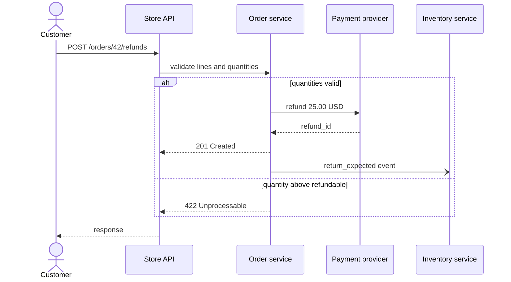
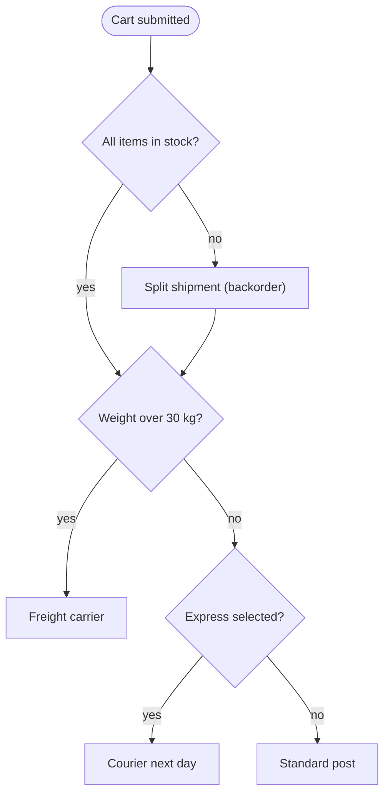
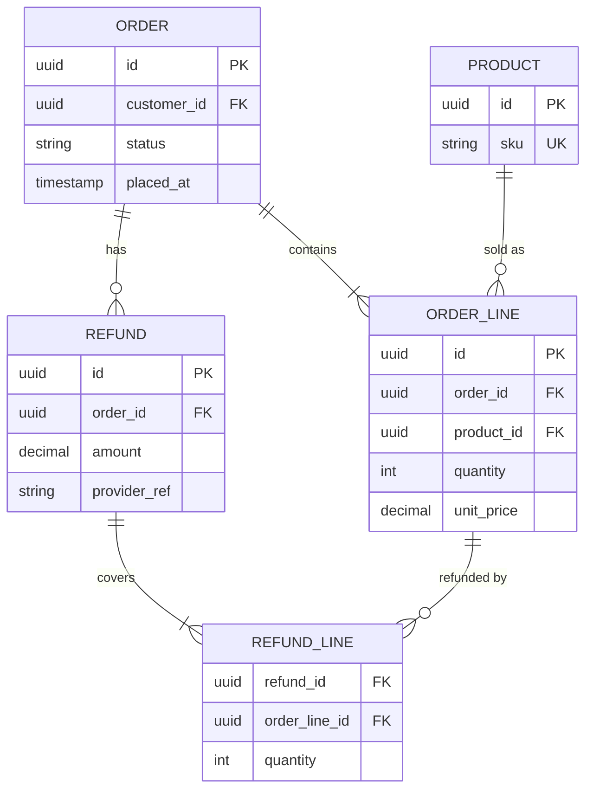
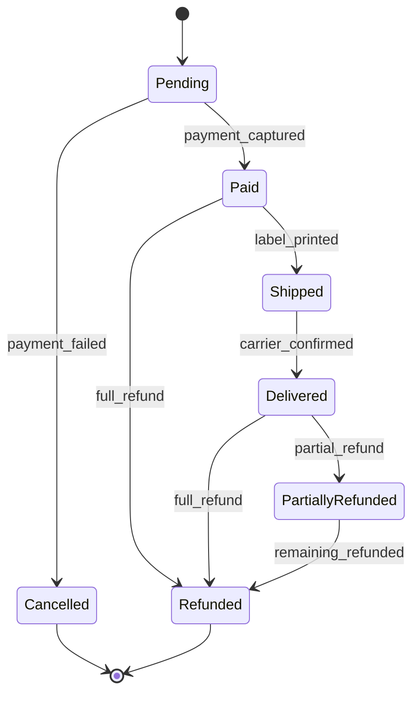

# Mermaid diagrams in RFCs

Add a diagram only when a reader would otherwise have to hold several moving parts in their head. One good diagram per RFC is usually enough.

## Which type to use

| You want to show | Use | Mermaid keyword |
|---|---|---|
| Calls between services or components over time, including async messages | Sequence diagram | `sequenceDiagram` |
| A decision process, a pipeline or how components connect | Flowchart | `flowchart` |
| Tables, their columns and how they relate | ER diagram | `erDiagram` |
| The lifecycle of one entity and the events that move it | State diagram | `stateDiagram-v2` |

If two types seem to fit, pick the one that matches the question a reviewer will ask. "What happens when the customer clicks refund?" is a sequence. "Which states can an order be in?" is a state diagram.

## Syntax rules that prevent rendering errors

- Put each diagram in a fenced code block with the language `mermaid`.
- Use plain ASCII ids without spaces (`OrderService`, `pay`). Put the readable text in a label: `pay[Payment provider]`.
- Wrap labels in double quotes when they contain parentheses, colons, slashes, commas or other punctuation: `A["Charge card (async)"]`.
- Do not use the bare word `end` as a node id or label in flowcharts and sequence diagrams. It closes blocks. Write `End` or `done` instead.
- Do not put `;` or `#` inside labels. Mermaid reads them as statement separators and entity codes.
- In flowcharts, declare the direction on the first line: `flowchart LR` or `flowchart TD`.
- In sequence diagrams, every `alt`, `opt`, `loop` and `par` block needs its own `end`.
- In ER diagrams, attribute lines are `type name`, with an optional `PK`, `FK` or `UK` after the name. Types cannot contain spaces or parentheses, so write `decimal` instead of `decimal(10,2)`.
- In state diagrams, use `stateDiagram-v2` and `[*]` for the start and end states. Transition labels follow a colon: `A --> B : event`.
- Keep a diagram under about 15 nodes. Split it if it grows past that.
- Avoid HTML in labels. Some renderers, including Notion and GitHub, strip or reject it.
- Preview the diagram before you share it (GitHub preview, mermaid.live or the editor plugin).

## Examples

### Sequence: partial refund

### Flowchart: choosing a shipping method at checkout

### ER: orders, lines and refunds

### State: order lifecycle

